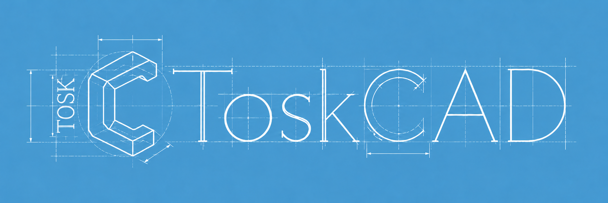
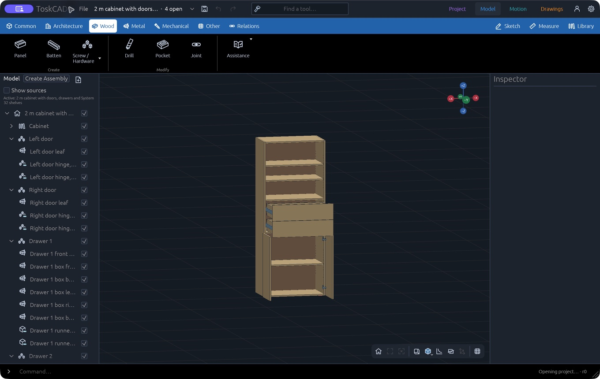
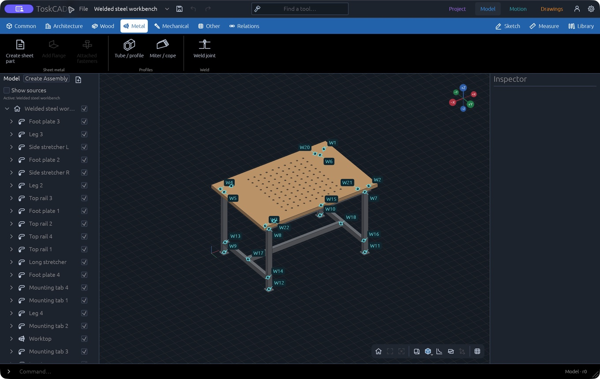
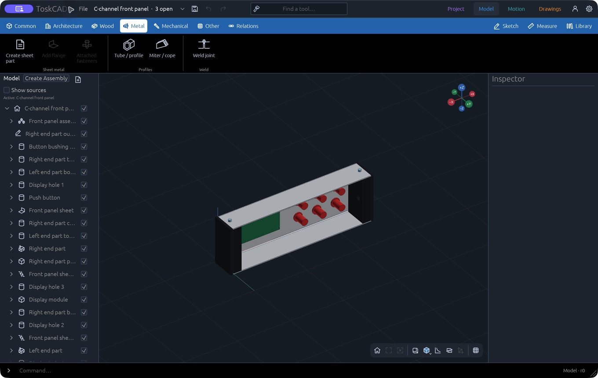
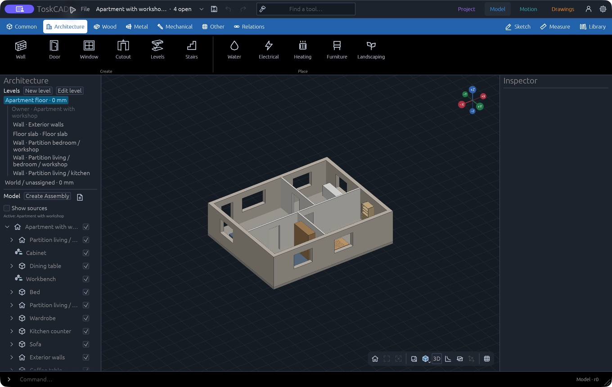

<p align="center">
  
</p>

# ToskCAD

Native parametric CAD built in Rust, with exact Open CASCADE geometry and a shared transactional document API for the desktop UI and local MCP control.

[Project website](https://kellertobias.github.io/TOSKCAD/) · [Build guide](docs/BUILDING.md) · [Contributing](CONTRIBUTING.md) · [Verification notes](docs/verification)

ToskCAD is under active development. Expect unfinished workflows and changing project formats. macOS interactive checks and Windows/Linux CI evidence are separate; verify the documented limits before using outputs for fabrication.

## Application screenshots

These native macOS screenshots show the cabinet, welded workbench, front panel and apartment in the November 9, 2026 build. All four projects are available as editable copies in the Examples browser. The cabinet shows its saved open pose.









The website also includes the model-derived [weld plan](website/assets/workbench-weld-plan.svg), [cabinet connector plan](website/assets/cabinet-connector-plan.svg) and [apartment floor plan](website/assets/apartment-plan.svg). Click an image there to inspect it in the page preview.

## Project foundation

The first native CAD dependency laboratory is under [spikes/native-foundation](spikes/native-foundation/README.md). It tests real constrained profiles, source-built OCCT solids/STEP, a Rust window and proof-only file/session behavior. It is separate from the native application host and does not establish completed application workflows.

An open-source native parametric CAD application planned for macOS, Windows and Linux, with compiled Rust application code and native geometry adapters. The native host and adapters are implemented; CAD workflows remain under development.

The [product plan](https://plans.tokenet.de/CAD/48) is maintained in PLAINER. [CAD-107](https://plans.tokenet.de/CAD/107) establishes the local repository and kernel-neutral bootstrap. [CAD-49](https://plans.tokenet.de/CAD/49) must prove the native geometry/solver/UI foundation before dependency integration and desktop packaging in [CAD-50](https://plans.tokenet.de/CAD/50).

## Build from source

```sh
./build
./build open
./build check
./build archive
```

Windows uses `./build.ps1`. The wrapper acquires the pinned native/Cargo dependencies, builds every shipped component and assembles the host application. Archives include a native runtime layout, notices and matching corresponding source. `./build archive install` is the explicit macOS install action; it is not run automatically. See [BUILDING.md](docs/BUILDING.md) for prerequisites, output paths and validation limits.

The native application includes Project, contextual sketch editing in Model, Motion, Drawings and Export. The [canonical document](docs/architecture/0004-canonical-document.md) provides stable identities, typed units, transactional commands and a dependency graph. The [native model evaluator](docs/architecture/0012-native-model-evaluation.md) owns exact OCCT solids on a bounded worker; the UI uses a separate candidate lane for checked Preview, Apply and Cancel. [Native project containers](docs/architecture/project-files.md) (`.tcd`; existing `.multicad` projects still open) preserve source and provider payloads, with atomic saves, migrations and explicit recovery copies.

The [native modeling checkpoint](docs/verification/native-modeling-2026-10-28.md) records shared-sketch extrusion, Undo/Redo, saved-project regeneration and the remaining limits. Advanced modeling controls, manufacturing exports and specialized workspaces remain under development. The [local MCP server](docs/architecture/mcp-server.md) (`multicad --mcp`) controls a headless project or the open window through the same transaction API. The foundation laboratory is a separate reference.

The [Parameters workflow checkpoint](docs/verification/native-parameter-workflow-2026-10-28.md) records table editing, expression diagnostics, stable renamed bindings, native solid rebuilding and save/reopen behavior.

[Parametric threads](docs/architecture/threads.md) documents the Mechanical thread feature, sourced basic metric presets, explicit Custom profiles and unavailable families. Cosmetic envelopes require a switch to Modeled before manufacturing export.

[Parametric gears](docs/architecture/gears.md) records supported families, canonical single/pair editing, native validation limits and remaining coverage. The [volume integration decision](docs/architecture/0033-oblique-volume-integration.md) records the native mass calculation and its numerical limits.

Mechanical catalog work follows the [retained hardware dimensions decision](docs/architecture/0026-retained-hardware-dimensions.md). The shared Library includes [four curated bearing mounting envelopes](library/README.md) with editable dimensions and pinned definitions. Complete fastener catalog coverage and connection integration remain under development.

[Architecture navigation](docs/architecture/architecture-navigation.md) groups placement commands under Water, Electrical, Heating, Furniture and Landscaping. Its compact parent controls and Back/Close preserve the active project and pending operation.

[Planting](docs/architecture/plants.md) adds generic editable trees and shrubs under Architecture, with linked canopy footprints for scaled drawings and presets in the shared included Library.

[Apartment equipment](docs/architecture/equipment.md) provides generic electrical, heating, sanitary and appliance families with explicit floor/wall/ceiling hosts, editable dimensions, linked plan symbols and presets in the same included Library.

The [spline editing checkpoint](docs/verification/native-spline-editing-2026-10-28.md) records exact trims, bounded tangent continuation, explicit contact choice, guarded background previews and native save/reopen checks.

The [occurrence-reference checkpoint](docs/verification/native-occurrence-references-2026-10-29.md) records exact finite projections and sections, independently placed assembly copies, explicit repair and source-bound native preview guards.

The [symbol checkpoint](docs/verification/native-symbols-2026-10-29.md) records pinned reusable definitions, exposed per-instance values, linked plans, independent Move/Copy and reviewed library updates.

[Associative feature transfer](docs/architecture/0021-associative-feature-transfer.md) derives holes and supported outer-face cutouts through explicit occurrence paths. Each receiving Part stores its diameter, clearance and cut depth; missing source references require explicit repair. The [native transfer checkpoint](docs/verification/native-feature-transfer-2026-10-28.md) records multi-material rail examples, source edits, native GUI repair and validation limits.

[Download ToskCAD](https://kellertobias.github.io/TOSKCAD/releases.html) for macOS (Apple silicon), Windows (x64) or Linux (x64). The page lists binaries from [GitHub Releases](https://github.com/kellertobias/TOSKCAD/releases), with matching source archives and SHA-256 checksums.

[CI and releases](.github/workflows/release.yml) test and package all three platforms before publishing a tag-only release on the tested `main` commit. GitHub is the primary repository. See [RELEASING.md](docs/RELEASING.md) for the release contract and activation gate.

## Project website

The short [GitHub Pages site](https://kellertobias.github.io/TOSKCAD/) lives in `website/` and uses plain HTML, CSS and JavaScript. The [Pages workflow](.github/workflows/pages.yml) deploys that directory after changes land on `main`; it is independent of application release publication. See [website/README.md](website/README.md) for preview instructions and screenshot provenance.

## UX reference

Open [mockup/index.html](mockup/index.html) directly, or run `node mockup/serve.mjs` and visit `http://127.0.0.1:4173`. Run `node mockup/verify.mjs` for the prototype's illustrative checks. Node.js is used by prototype and release development tools, not by the native application.

The prototype illustrates **Parameters, Sketch, Model, Drawings, Render, Export**, contextual ribbons, and global Measure/Library/MCP controls. Use **Explore workflows** for examples. CAD geometry and outputs are simulated.

The [current native layout](docs/architecture/0005-native-editing.md) has five modes, a Project parameter table with left-side actions and one file-metadata sidebar, and rendering under Export. Add Sketch and Import are global right-side actions. Sketch editing belongs to Model and its tools appear after creating or opening a sketch; Model has no Face Sketch command. The prototype remains an illustrative reference and retains its earlier layout.

See the [workflow guide and prototype boundaries](mockup/README.md).

## Contributing and license

Read [CONTRIBUTING.md](CONTRIBUTING.md) and [AGENTS.md](AGENTS.md) before development. The application source is licensed under [GNU GPL v3 or later](LICENSE) (`GPL-3.0-or-later`). Future native dependencies require their own version/license/distribution review before integration.
