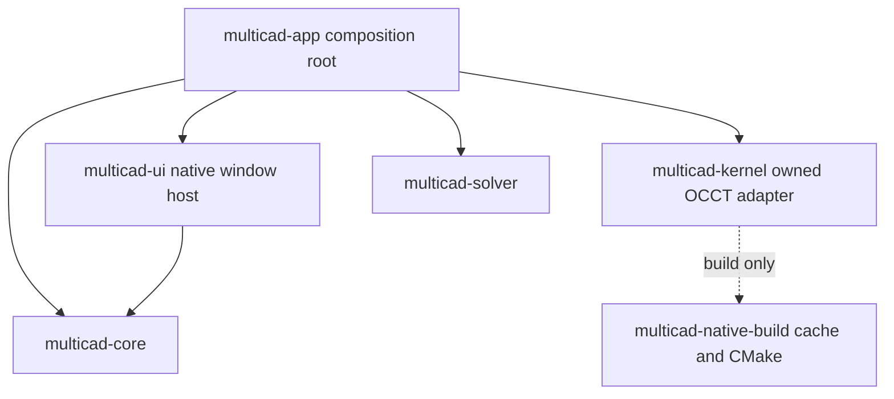

# 0003: Native dependency and host integration

CAD-50 extends the locally tested CAD-49 proof. The runtime dependency graph is now explicit:

The core imports neither UI nor native geometry. Kernel and solver do not import UI. The UI host does not import kernel/solver. The application executable assembles components and supplies its UI implementation through `launch_with`; adding document commands or domain UI does not require embedding them into the window/GPU bootstrap.

The native adapter only exposes opaque owned shapes and copied display meshes. Its current small profile/cut API is a proven integration surface, not the full CAD-54 modeling service. Solver IDs remain internal to the adapter. CAD-51/53 define the canonical entities, commands and revisioned evaluator ports before workspaces or file codecs own model state.

## Build and cache identity

Native source is pinned by official archive digest and immutable upstream revision in `native-dependencies.json`. The extracted source tree is also content-hashed, so native edits/patches cannot silently hit a cache for different source. The digest is compiled into the kernel and reported by the application. Runtime packaging compares it against the source tree that accompanies the artifact.

OCCT uses a locked cache per target, compiler/ABI/SDK, source and configuration. The configuration identity is derived from the same toolkit/module/option constants used to invoke CMake. Rust UI edits, formatter changes and build-vs-check output directories do not constitute a different native library. CMake builds OCCT in Release mode independently of the Rust profile. The compiler used for cache identity matches cmake-rs' fixed optimization/debug setup. Native completion markers are only written after the required libraries exist. Crashes/failed builds leave no successful cache marker.

The wrapper works from outside the repository and builds all shipped workspace products. System SDK/build tools are detected with actionable instructions; the wrapper does not hide global installation or require Xcode's GUI. Windows/Linux artifacts are built on their own GitHub runners. Windows MSVC uses a static CRT and packaged dependency audits reject unbundled VC runtime imports. macOS allows only system-library dependencies in this static development layout; Linux rejects unresolved or developer-path dependencies.

## Distribution and source closure

Every platform runtime ZIP has a matching source ZIP. The source contains the exact Git tree, Cargo.lock, vendored registry dependencies, original OCCT archive, actual extracted OCCT source (including any local patches) and build/relink instructions. A consumer can rebuild without the original checkout or a preinstalled OCCT. Runtime resources retain the application/OCCT licenses, additional exception, third-party notice files (including font notices) and a resolved dependency inventory.

Aggregate verification rejects missing, stale, changed or mismatched source/runtime artifacts. GitHub's publisher still operates only on tested mirrored main commits, makes tag-only releases and is disabled until real repository/mirror verification. No release commit/version file bump, Forgejo credential, remote creation or push is introduced.

Native `open` only replaces the previous wrapper-owned process after a successful build and executable-path verification. The current host owns no document. Before editable sessions are integrated, the command host must provide a graceful close/dirty-document protocol in place of SIGTERM. Install is an explicit macOS-only action, refuses a running installed app, stages replacement with rollback/backup and preserves application configuration. Neither installation nor publisher signing/notarization is claimed tested here.

## Scope boundaries

CAD-50 integrates dependencies and a native window, diagnostics, real packaged-runtime checks and distribution tooling. It does not promote the lab's private JSON/session/descriptor registry into the production file format or command/plugin API. Canonical document/DAG, transactions, persistent references, recovery, the retained viewport, complete shell/workspaces and MCP remain their separately claimed plans.

Local macOS results, extracted-archive tests and actual GitHub/physical-platform results must remain distinct. Hosted runs cannot be proven before repositories exist. The current Linux portable format targets Ubuntu 24.04+ system graphics libraries; actual GPU availability is a runtime prerequisite. Runtime UI memory/performance and manufacturing acceptance cannot be inferred from the headless smoke check.
